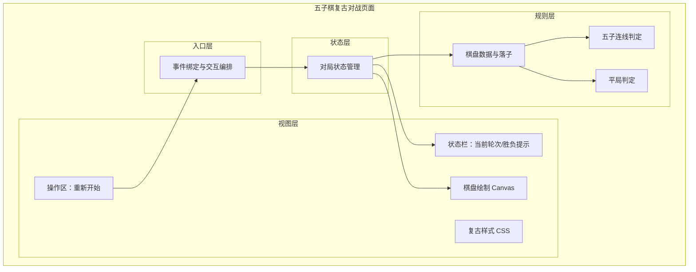
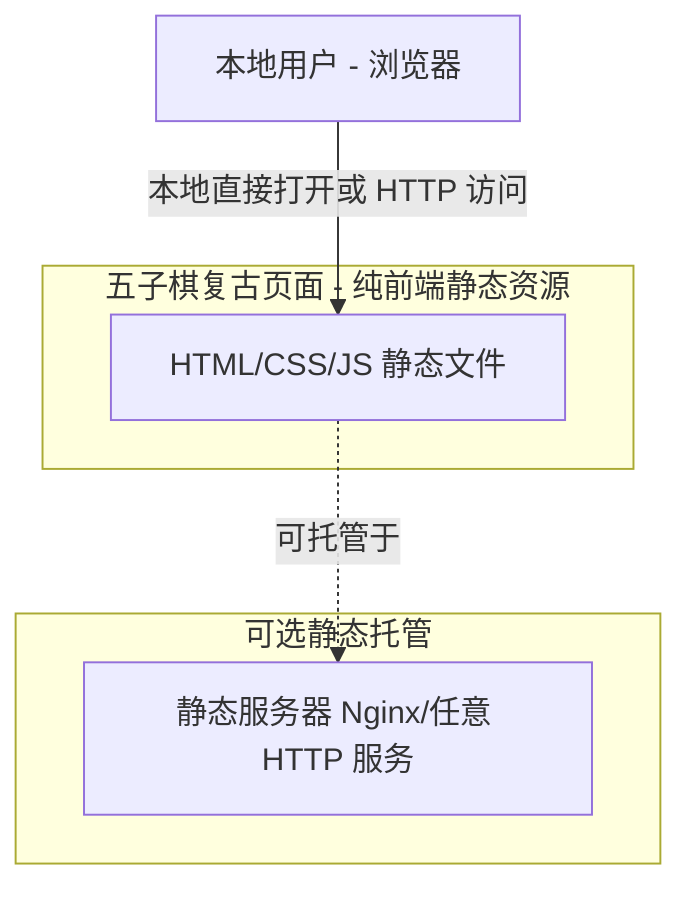
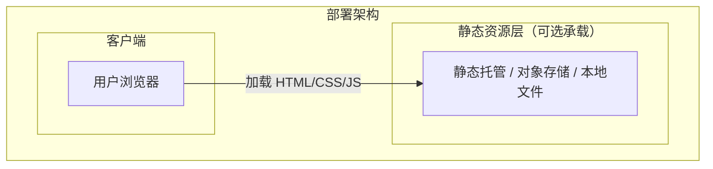
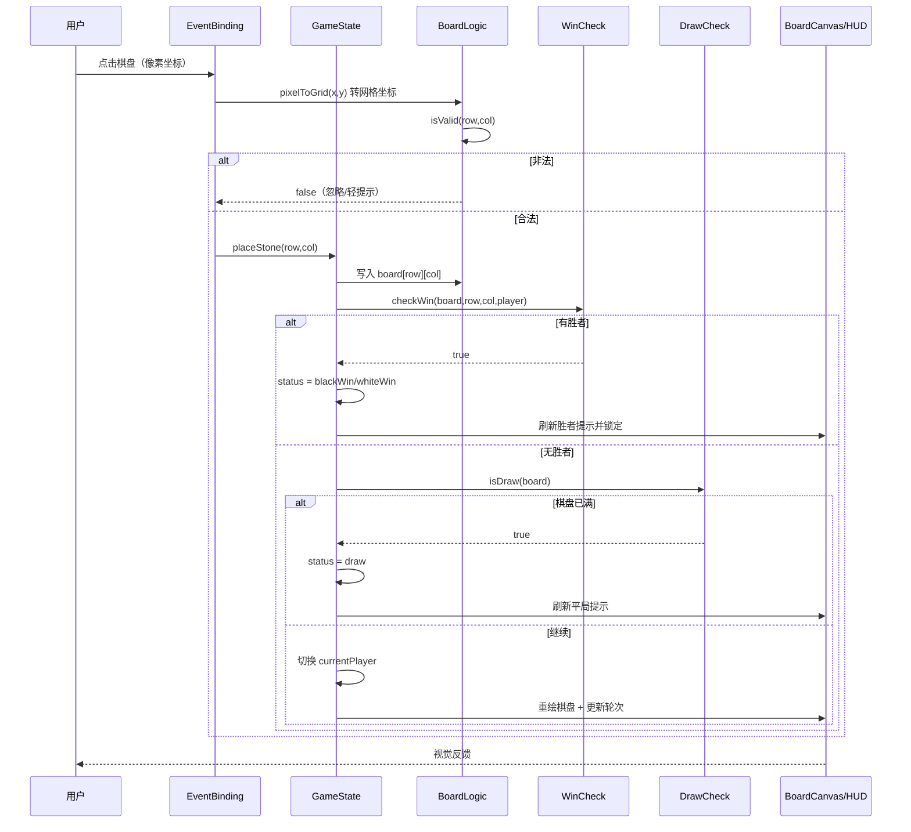
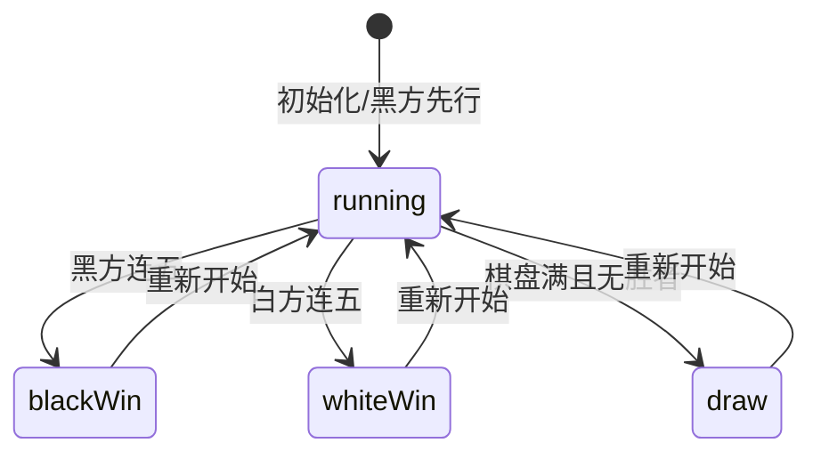

> **文档元信息**
>
> | 项目 | 内容 |
> |------|------|
> | 文档版本 | v1.0 |
> | 作者 | AiWork（自动生成） |
> | 创建日期 | 2026-10-15 |
> | 需求来源 | 任务需求描述（"用js写一个五子棋页面，分为白色方和黑色方，要求界面复古"） |
> | 评审状态 | 待评审 |

# 五子棋对战页面（复古风格）系分设计

## 1. 需求与范围

### 1.1 背景与目标

- **背景**：当前仓库为全新空仓库（仅含 `.git` 与 `test1010` 占位文件），无既有架构、模块文档或历史系分资产，本次为全新（greenfield）需求。
- **目标**：使用 JavaScript 实现一个纯前端五子棋对战页面，棋局分为白色方与黑色方两方轮流落子，界面采用复古/怀旧视觉风格。
- **使用对象**：单机本地双人对战的网页使用者（同一台设备上黑、白双方轮流操作），无登录、无账号、无网络对局需求。

### 1.2 核心功能

1. 15×15 标准五子棋棋盘绘制与落子。
2. 黑白两方轮流落子，明确当前轮到哪一方。
3. 五子连线胜利判定（横、竖、两条斜对角线，五子及以上）。
4. 胜负判定后锁定棋盘并展示结果（黑胜/白胜）。
5. 平局（棋盘下满且无胜者）判定与提示。
6. 重新开始对局。
7. 复古风格界面（配色、棋盘纹理、字体）。
8. 落子合法性校验（目标位置空闲、不允许重叠落子）。

### 1.3 约束与非功能要求

- **技术栈**：原生 JavaScript（HTML + CSS + JS，无框架、无构建依赖），单个静态页面即可运行，可直接用浏览器打开或通过任意静态服务器托管。
- **兼容性**：现代浏览器（Chrome/Edge/Firefox/Safari 当前稳定版本），使用 ES6 语法与 Canvas API。
- **离线可用**：不依赖任何第三方 CDN、字体或后端服务。
- **性能**：15×15 棋盘，单局下子数 ≤ 225，任何算法均可在毫秒级完成判定，无性能瓶颈。
- **部署形态**：静态资源部署，无后端服务。

### 1.4 排除范围

- 不包含人工智能/电脑对弈（人机对战）。
- 不包含网络联机对战、房间、观战、聊天、回放。
- 不包含账户、登录、积分、战绩持久化。
- 不包含棋谱保存/导入导出（如以后需要可扩展）。
- 不包含悔棋、禁手（黑棋禁手）、计时、音效等增强玩法（可作后续扩展预留，不在本期实现）。
- 无后端、无数据库、无服务端接口。

### 1.5 需求功能清单与优先级

| 编号 | 功能点 | 优先级 | PRD 原始描述 | 备注 |
|------|--------|--------|--------------|------|
| F01 | 绘制 15×15 五子棋棋盘（含星位/天元） | P0 | 五子棋页面、界面复古 | 棋盘为复古视觉的核心载体 |
| F02 | 黑、白两方轮流落子，明确轮次提示 | P0 | 分为白色方和黑色方 | 黑方先行（五子棋通用规则） |
| F03 | 落子合法性校验（不得落于已有棋子、不得越界） | P0 | 五子棋页面 | 基础规则 |
| F04 | 五子连线胜利判定（横/竖/两条斜对角线） | P0 | 五子棋页面 | 核心胜负规则 |
| F05 | 胜负提示与棋盘锁定 | P0 | 五子棋页面 | 胜利后不可继续落子 |
| F06 | 平局判定与提示 | P1 | 五子棋页面 | 棋盘满且无胜者 |
| F07 | 重新开始对局 | P0 | 五子棋页面 | 一局结束或随时重开 |
| F08 | 经典复古视觉风格（配色/纹理/字体/装饰） | P0 | 要求界面复古 | 视觉验收要点 |

### 1.6 假设与待确认项

| 编号 | 假设/待确认内容 | 当前假设 | 确认状态 |
|------|-----------------|----------|----------|
| A01 | 棋盘规格 | 标准 15×15 棋盘（五子棋通用规格） | 待确认 |
| A02 | 先行方 | 黑方先行（五子棋国际通用规则） | 待确认 |
| A03 | 对战模式 | 单机本地双人对战（同屏轮流操作），不联网不 AI | 待确认 |
| A04 | 是否含禁手 | 不实现黑棋禁手（简化规则，仅做"连五即胜"） | 待确认 |
| A05 | 技术形态 | 原生 HTML/CSS/JS 单文件或三文件静态页面，无构建工具 | 待确认 |
| A06 | `board-knowledge-search` 检索 | 当前 Skills 注册表中无该技能，未执行第三方知识检索，知识库资源以仓库现状为准 | 已确认 |
| A07 | 仓库基线 | 仓库为全新空仓库，采用全量设计模式（非增量） | 已确认 |
| A08 | 复古风格的具体定义 | 复古解释为：羊皮纸/木纹质感棋盘、暗黄棕色调、衬线字体（如宋体/Georgia）、像素或描边厚重按钮，无现代扁平、无暗黑霓虹风格 | 待确认 |

## 2. 架构与模块

本需求为**纯前端展示与交互型页面**，无服务端、无数据库、无中间件。整体为单页应用（SPA）形态的静态资源，架构层级为「视图层（DOM/Canvas）— 状态层（对局状态）— 规则层（棋盘逻辑）— 入口层（事件绑定）」。

### 2.1 功能架构

**模块清单**

| 模块 | 职责 | 依赖 |
|------|------|------|
| BoardCanvas（棋盘绘制） | 绘制 15×15 棋盘、格子、星位、落子、最近一手标记 | GameState |
| HUD（状态栏） | 展示当前轮到黑/白方，展示胜利/平局提示 | GameState |
| Controls（操作区） | 提供「重新开始」按钮 | EventBinding |
| RetroStyle（复古样式） | 页面整体复古配色、字体、纹理、按钮样式 | 无 |
| GameState（对局状态管理） | 维护棋盘数据、当前轮次、对局状态（进行中/黑胜/白胜/平局），暴露落子/判胜/重开的读写接口 | BoardLogic、WinCheck、DrawCheck |
| BoardLogic（棋盘数据与落子） | 15×15 二维数据、落子坐标换算、合法性校验、坐标↔数组索引映射 | GameState |
| WinCheck（胜利判定） | 以最新落子为中心，向横/竖/两条斜对角线共 8 方向延伸计数，判定 ≥5 连线 | GameState |
| DrawCheck（平局判定） | 判定棋盘是否下满且无胜者 | GameState |
| EventBinding（事件编排） | 监听 Canvas 点击与「重新开始」点击，串联状态更新、重绘、提示刷新 | GameState、BoardCanvas、HUD |

### 2.2 应用集成架构

**集成关系说明：**

| 调用方 | 被调用方 | 协议 | 接口类型 | 说明 |
|--------|----------|------|----------|------|
| 本地用户 | 浏览器加载静态页面 | file:// 或 HTTP | 静态资源 | 无需后端，直接渲染与交互 |
| 浏览器 | （可选）静态服务器 | HTTP | 静态资源 | 可直接双击打开，也可由任意静态服务器托管 |

本系统**无外部系统集成、无后端接口、无数据库**，集成关系极简。

### 2.3 部署架构

**部署说明：**
- **负载均衡层**：本项不适用，原因：纯静态前端，无服务端实例，无负载均衡需求；如部署到 CDN 由 CDN 承担分发。
- **应用层**：无服务端进程，静态资源直接下发，浏览器内完成全部逻辑运行。
- **数据层**：本项不适用，原因：无持久化数据，对局状态仅存在于浏览器内存中。

## 3. 数据模型与存储

本需求为纯前端单机对局，**无后端持久化、无数据库、无缓存/MQ**。对局状态在浏览器运行期内存中维护，页面刷新即重置。数据形态说明如下。

### 3.1 内存数据结构（非持久化实体）

| 实体名称 | 实体说明 | 所属模块 | 与其他实体的关系 |
|----------|----------|----------|-----------------|
| Board（棋盘数据） | 15×15 二维数组，存储每个交叉点的落子状态（空/黑/白） | 规则层 BoardLogic | 被 GameState 持有 |
| GameStatus（对局状态） | 对局进行状态（进行中/黑胜/白胜/平局）与当前轮次 | 状态层 GameState | 1:1 关联 Board |
| Move（落子记录） | 一次落子的坐标与颜色（可选，用于最近一手标记） | 状态层 GameState | N 条归属于 1 个 Board |

**模型说明：**
- Board 为固定容量 15×15 的网格数据，每个单元格取值为三态枚举（空=0、黑=1、白=2）。
- GameStatus 持有「当前轮到谁」与「终局状态」，二者共同决定交互是否可用。
- 无持久化存储，因此不存在表结构、索引、迁移、租户隔离等数据库设计项；本机刷新即清空。

## 4. 接口设计

本需求无服务端接口。对外暴露的是**前端内部 JS 函数接口**（模块间调用约定）与**浏览器事件**。

### 4.1 oneapi（Web 控制台接口）

本项不适用，原因：纯前端页面，无后端服务，不存在 `/api` 接口。

### 4.2 OpenAPI（对外接口）

本项不适用，原因：无对外提供服务的能力或需求。

### 4.3 内部接口（JS 模块函数）

| 编号 | 接口名称 | 所属对象/类 | 方法签名（函数签名） |
|------|----------|-------------|----------------------|
| S01 | 落子 | game | `placeStone(row, col)` |
| S02 | 合法性校验 | board | `isValid(row, col)` |
| S03 | 胜利判定 | rules | `checkWin(board, row, col, player)` |
| S04 | 平局判定 | rules | `isDraw(board)` |
| S05 | 重新开始 | game | `reset()` |
| S06 | 棋盘绘制 | renderer | `draw(board, lastMove)` |
| S07 | 坐标换算 | board | `pixelToGrid(x, y)` |

### 4.4 集成接口（Integration 层）

本项不适用，原因：无外部系统集成。

## 5. 功能模块设计

### 5.1 棋盘数据与落子（BoardLogic）

#### 5.1.1 存储结构设计

| 字段名 | 数据结构 | 约束 | 默认值 | 说明 |
|--------|----------|------|--------|------|
| board | number[][]（15×15） | 二维数组，长度各 15 | 全 0 | 0=空、1=黑、2=白 |
| size | number | 固定 15 | 15 | 棋盘边长（交叉点数） |
| currentPlayer | number | 取值 1 或 2 | 1（黑方先行） | 当前轮次颜色 |
| status | string | running/blackWin/whiteWin/draw | running | 对局状态 |
| lastMove | {row,col} \| null | 对象或空 | null | 最近一手坐标，用于高亮标记 |

**枚举与常量定义**

| 枚举名称 | 取值 | 含义 | 关联字段 |
|----------|------|------|----------|
| CELL_STATE | 0 / 1 / 2 | 空 / 黑子 / 白子 | board 单元格 |
| PLAYER | BLACK=1、WHITE=2 | 黑方、白方 | currentPlayer |
| GAME_STATUS | running / blackWin / whiteWin / draw | 进行中 / 黑胜 / 白胜 / 平局 | status |

#### 5.1.2 内部函数详细设计

##### S02 isValid(row, col) 合法性校验

- **签名**: `isValid(row, col): boolean`
- **描述**: 校验目标交叉点是否可落子。
- **入参**:

| 参数名称 | 类型 | 是否必填 | 描述 |
|----------|------|----------|------|
| row | number | 是 | 落子行（0~14） |
| col | number | 是 | 落子列（0~14） |

- **出参**: `boolean`，true=可落子，false=不可落子。
- **错误码**: 本项为内部函数，不返回业务错误码；非法落子由交互层静默忽略或给出轻提示。
- **业务规则**:
  - 目标坐标必须在 0~14 范围内，越界非法。
  - 目标交叉点必须为空（board[row][col] === 0）。
  - 对局状态必须为 running，终局后不可落子。

### 5.2 胜利与平局判定（WinCheck / DrawCheck）

#### 5.2.1 内部函数详细设计

##### S03 checkWin(board, row, col, player) 胜利判定

- **签名**: `checkWin(board, row, col, player): boolean`
- **描述**: 以最后落下的棋子为中心，沿 4 条直线方向判定是否形成五子连线。
- **入参**:

| 参数名称 | 类型 | 是否必填 | 描述 |
|----------|------|----------|------|
| board | number[][] | 是 | 棋盘数据 |
| row | number | 是 | 最新落子行 |
| col | number | 是 | 最新落子列 |
| player | number | 是 | 当前落子方（1/2） |

- **出参**: `boolean`，true=形成五子连线。
- **业务规则**:
  - 4 个方向向量：[1,0]（竖）、[0,1]（横）、[1,1]（主斜）、[1,-1]（副斜）。
  - 每个方向向正反两端各延伸，累计同色连续棋子数（含自身起始 1）。
  - 任一线方向累计 ≥5 即判胜。
  - 仅以最新落子为中心判定，可保证正确性且效率 O(1)（每方向最多检查 8 个格）。

##### S04 isDraw(board) 平局判定

- **签名**: `isDraw(board): boolean`
- **描述**: 棋盘已满且无胜者。
- **出参**: `boolean`，true=平局。
- **业务规则**: 累积落子数达到 225（15×15）且未触发胜利判定。

#### 5.2.2 子功能详细设计

##### 5.2.2.1 落子主流程（F02/F03/F04/F05/F06）

**业务规则：**

| 规则编号 | 规则描述 | 校验时机 | 不满足时的处理 |
|----------|----------|----------|--------------|
| R01 | 黑方先行 | 对局初始化 | currentPlayer=BLACK(1) |
| R02 | 只能落在空交叉点 | 每次落子前 | 忽略本次点击（非法落子不做状态变更） |
| R03 | 坐标越界忽略 | 每次点击 | 忽略点击（点击落在棋盘外不响应） |
| R04 | 终局后禁止落子 | 每次落子前 | 忽略点击，棋盘保持锁定 |
| R05 | 连五即胜 | 每次落子后 | 锁定棋盘，显示黑/白方胜利 |
| R06 | 满盘无胜者判平 | 每次落子后 | 锁定棋盘，显示平局 |
| R07 | 胜后不切换轮次 | 胜局结算 | 终结流程，不再交换 currentPlayer |

**异常场景：**

| 异常场景 | 处理方式 |
|----------|----------|
| 点击落在棋盘外（留白/边距） | pixelToGrid 计算出界，不触发落子 |
| 重复点击已有棋子的交叉点 | isValid 校验失败，静默忽略 |
| 胜利后仍点击棋盘 | status 非 running，落子被阻断 |
| Canvas 高分屏缩放导致坐标偏移 | 对鼠标坐标按 Canvas 实际像素与 CSS 尺寸比例换算（devicePixelRatio 处理） |

**并发控制：**

- 并发场景：单机同步 JS 单线程环境，用户点击为顺序事件，不存在多线程并发写。
- 控制策略：无并发风险，原因：浏览器单线程事件循环天然串行，状态变更在一次点击事件内原子完成；无需锁或版本号。

**状态机设计（对局状态 status）：**

**状态流转规则：**

| 当前状态 | 目标状态 | 流转条件 | 前置校验 | 触发动作 |
|----------|----------|----------|----------|----------|
| running | blackWin | 黑方落子后形成五连线 | 无 | 锁定棋盘、显示"黑方胜利" |
| running | whiteWin | 白方落子后形成五连线 | 无 | 锁定棋盘、显示"白方胜利" |
| running | draw | 落子数达 225 且无胜者 | 无 | 锁定棋盘、显示"平局" |
| blackWin / whiteWin / draw | running | 用户点击「重新开始」 | 无 | 清空棋盘、重置 currentPlayer=黑方、重绘 |

### 5.3 棋盘绘制（BoardCanvas）

#### 5.3.1 子功能详细设计

##### 5.3.1.1 复古棋盘绘制（F01）

- **描述**: 使用 Canvas 2D 绘制复古质感棋盘与棋子。
- **要点**:
  - 棋盘底色采用羊皮纸/木质米黄（如 `#d9b98c`~`#e8d5a8`）+ 木纹或网格十字线。
  - 交叉点处绘制横纵网格线，颜色为深棕（如 `#5b4636`）。
  - 星位/天元（3-3、3-11、7-7、11-3、11-11 五处）绘制实心圆点。
  - 黑子为深墨黑带轻微高光，白子为米白/象牙白带描边，棋子落在交叉点上。
  - 最近一手用小型圆点或高亮圈标记。
  - 页面整体采用复古字体（衬线，如 Georgia / "Songti SC" / "SimSun" 降级）、暗黄棕背景纹理、厚重描边按钮。

##### 5.3.1.2 坐标换算 pixelToGrid（S07）

- **描述**: 将鼠标点击的像素坐标换算为棋盘交叉点行列坐标。
- **业务规则**:
  - 依据棋盘起始偏移、格子间距计算最近交叉点。
  - 命中距离超过一定阈值（如半格）视为无有效交叉点。
  - 统一按 devicePixelRatio 缩放换算，消除高分屏偏移。

### 5.4 交互与状态（EventBinding / HUD / Controls）

#### 5.4.1 子功能详细设计

##### 5.4.1.1 轮次提示与终局提示（F02/F05）

- **描述**: HUD 实时展示「轮到黑方（黑先行）」/「轮到白方」，终局展示「黑方胜利」「白方胜利」「平局」。
- **业务规则**:
  - 进行中：提示文本随 currentPlayer 更新（黑/白）。
  - 终局：提示文本切换为结果，页面不可再落子。

##### 5.4.1.2 重新开始（F07）

- **描述**: 点击「重新开始」按钮清空对局并回到黑方先行。
- **业务规则**:
  - 重置 board 为全 0、currentPlayer=黑、status=running、lastMove=null。
  - 立即重绘棋盘并刷新 HUD。

## 6. 非功能性需求设计

### 6.1 高可用性

本项不适用，原因：纯前端静态页面无服务端，无 "上下游、实例容灾" 概念；可用性取决于静态资源是否可达。若托管，可借助 CDN 多节点保障资源可达性；本地打开则完全离线可用。

### 6.2 可扩展性

- 代码按「视图/状态/规则/入口」分层，后续可平滑扩展：悔棋（维护落子栈）、禁手规则（扩展 WinCheck / Rules 模块）、人机 AI（在 EventBinding 中接管一方落子）、联网对战（新增网络层而棋盘规则层可复用）。
- 规则层与渲染层解耦，棋盘尺寸（size 常量）可扩展为非标棋盘。
- 单文件即可运行、无构建依赖，易分发易维护。

### 6.3 稳定性/可靠性

- 边界处理：首手落子（无 lastMove）、最后一手落子（满盘）、连续多次快速点击（事件串行处理）、高分屏缩放坐标——均已在异常场景表覆盖。
- 胜利判定以最新落子为中心做方向延伸，任何棋形均可正确判定，算法稳定。
- 状态推进在单个事件内完成，不存在跨帧数据竞争导致的状态不一致。

### 6.4 安全性设计

- **6.4.1 账户系统方案**：本项不适用，原因：纯本地无登录无账户。
- **6.4.2 授权&访问控制**：本项不适用，原因：无数据查询、无权限资源；页面为公共本地交互。
- **6.4.3 数据防护方案**：本项不适用，原因：不采集、不存储、不传输任何敏感数据（仅浏览器内存中的棋盘状态）。
- **输入安全**：无表单提交与后端注入面；对点击坐标的换算输出限制在棋盘索引范围，天然阻断越界。

### 6.5 监控/统计/日志/告警

本项不适用，原因：纯前端本地对局，无服务端链路、无接口调用量、无异常日志采集需求。若后续联网化可再引入前端埋点统计对局数/胜率/异常。

## 7. 变更三板斧

### 7.1 可监控

本项不适用，原因：无服务端、无接口、无外部依赖，无可监控的运行时链路。静态资源可通过托管的访问日志观测分发情况；本地打开场景无监控点。

### 7.2 可灰度

本项不适用，原因：单机静态页面无多版本流量分发语义。变更发布即为整体替换静态资源；若托管于 CDN，可通过版本化文件路径（如 `index.v2.html`）实现新旧版本并存，但本期不引入灰度框架。

### 7.3 可应急

- 纯静态资源变更可直接用「替换/回滚静态文件」应急，回滚依赖简单（无数据库 schema、无上下游接口兼容性问题）。
- 代码层预留功能开关思路（非本期实现）：可通过 URL 参数或常量开关关闭新增玩法（如后续的禁手/AI），快速切回最简对局逻辑；因无后端，开关即前端常量或运行时配置。
- 回滚无上下游兼容性问题：无持久化数据、无对外协议，回滚旧静态文件即完整恢复。

---

## 附：方案检查结果（Step 9 checklist）

| 检查项 | 结果 | 说明 |
|------|------|------|
| 模块划分合理性检查 | 通过 | 视图/状态/规则/入口四层各自单一职责，无循环依赖 |
| 依赖关系合理性 | 通过 | 仅依赖浏览器与可选静态托管，无下游服务 |
| 单点问题检查（部署层面） | 不适用 | 无服务端实例 |
| 表模型设计范式检查 | 不适用 | 无数据库表 |
| 隐私安全检查 | 通过 | 无任何敏感信息 |
| 兼容性检查（接口） | 不适用 | 无对外接口 |
| 兼容性检查（表） | 不适用 | 无数据库表 |
| 数据迁移检查 | 不适用 | 无持久化数据 |
| 一致性检查（功能点） | 通过 | F01~F08 均在第 5 章有对应设计（F08 对应 5.3.1.1 复古绘制） |
| 一致性检查（表） | 不适用 | 无表实体，仅内存结构在第 3 章说明 |
| 一致性检查（接口） | 通过 | S01~S07 均在第 5 章有定义 |
| 一致性检查（枚举） | 通过 | CELL_STATE/PLAYER/GAME_STATUS 与 board/currentPlayer/status 一致 |
| 状态机完整性检查 | 通过 | status 状态机 + 流转规则完整，无孤岛状态 |
| 并发风险检查 | 通过 | 单线程串行，无并发风险 |
| 单点问题检查（定时任务层面） | 不适用 | 无定时任务 |
| 非功能性设计可行性检查 | 通过 | 离线/单机可行性高，无外部依赖 |
| 变更三板斧设计可行性检查（可监控） | 不适用 | 无服务端链路 |
| 变更三板斧设计可行性检查（可灰度） | 不适用 | 单机静态无灰度语义，已说明版本化路径方案 |
| 变更三板斧设计可行性检查（可应急） | 通过 | 替换/回滚静态文件即可，无上下游兼容问题 |