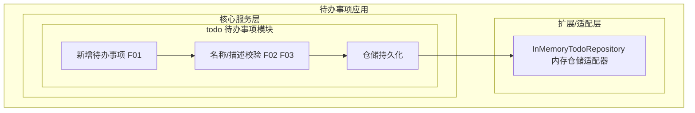
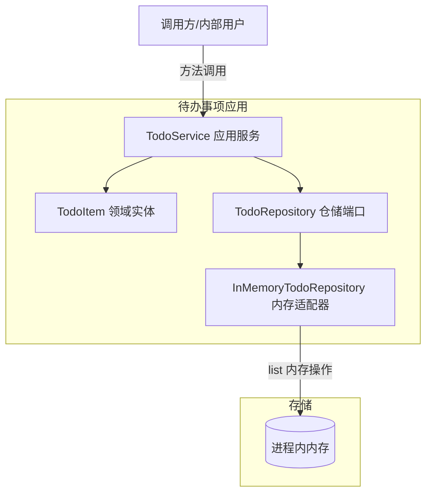
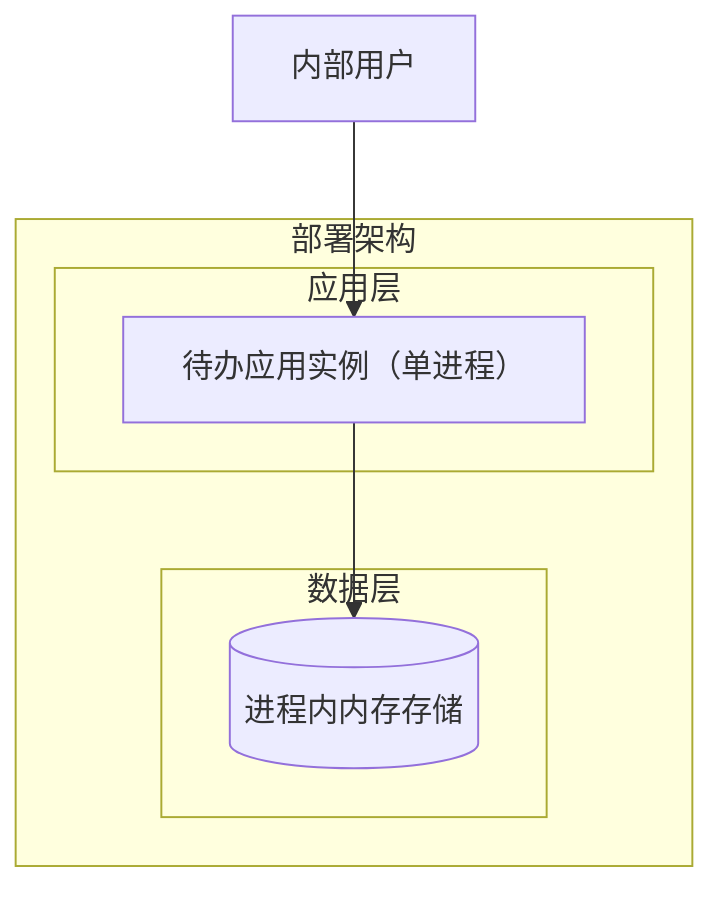
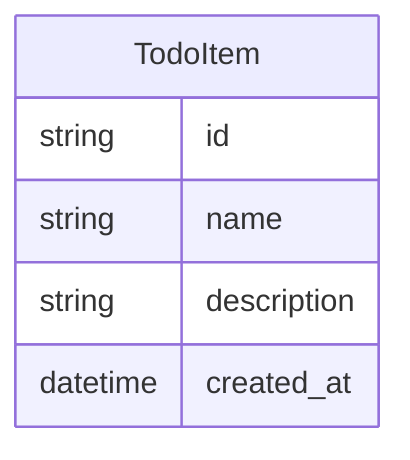
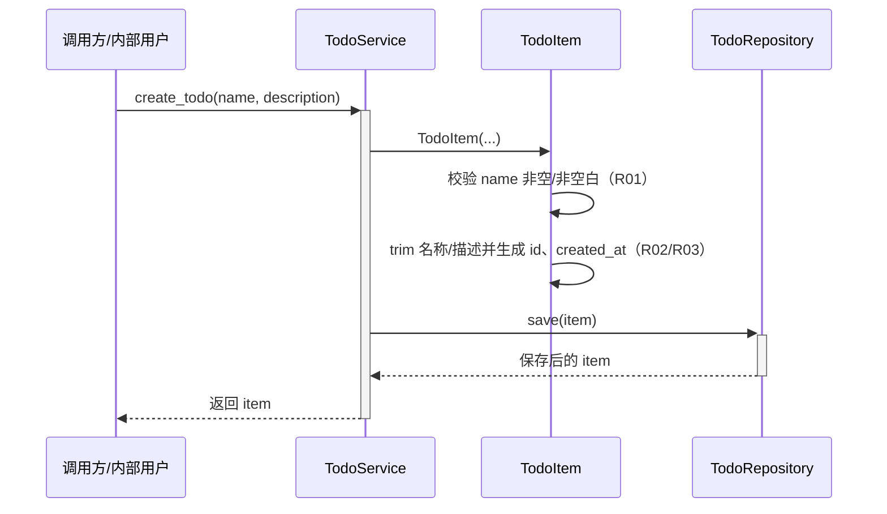

> **文档元信息**
>
> | 项目 | 内容 |
> |------|------|
> | 文档版本 | v1.1 |
> | 作者 | aiwork |
> | 创建日期 | 2026-10-19 |
> | 需求来源 | 任务需求：帮助用户记录日常待办事项（核心功能：新增待办事项） |
> | 评审状态 | 待评审 |

# 待办事项创建功能 系分设计

## 1. 需求与范围

### 1.1 背景与目标

为内部用户提供记录日常待办事项的能力。本阶段只落地最小闭环——「新增待办事项」，让用户能够以事项名称 + 事项描述两条信息记录一条待办。功能定位为内部使用的小工具，重在跑通「录入 → 校验 → 持久化」的完整链路，为后续扩展（编辑、完成、删除、查询、对外 API）预留分层扩展点，但不在此次范围内实现。

### 1.2 核心功能

- 新增待办事项：录入事项名称（必填）与事项描述（可选），生成唯一标识与创建时间并保存。
- 事项名称处理：非空、非空白，首尾空白自动去除。
- 事项描述处理：可空，为空时按空字符串保存，首尾空白自动去除。

### 1.3 约束与非功能要求

- 技术栈：Python 3（建议 3.11+）；优先使用标准库 `dataclasses` / `uuid` / `datetime`，运行期无第三方依赖；测试框架 `pytest`。
- 目标用户：内部用户，无对外商业化诉求。
- 最小闭环：仅「创建」，不涉及编辑、删除、完成状态、列表查询界面、权限体系。
- 交付形态：纯 Python 库/可直接调用（或命令行入口）的分层代码，不引入 Web 框架依赖。

### 1.4 排除范围

下列能力明确不在本期范围（保持最小闭环）：

- 待办事项的编辑、删除、完成/取消完成等状态流转。
- 列表/详情查询的用户界面与对外 REST/OpenAPI 暴露。
- 多用户体系、登录态、租户隔离、水平/垂直权限。
- 数据库/持久化中间件接入（本期采用内存存储实现）。

### 1.5 需求功能清单与优先级

| 编号 | 功能点 | 优先级 | PRD 原始描述/章节 | 备注 |
|------|--------|--------|-------------------|------|
| F01 | 新增待办事项 | P0 | 核心功能：新增待办事项 | 创建一条待办并保存 |
| F02 | 事项名称必填校验 | P0 | 任务信息：事项名称 | 名称 None/空/纯空白时拒绝 |
| F03 | 事项描述可选及归一化 | P0 | 任务信息：描述 | 可为空，trim 后保存 |

### 1.6 假设与待确认项

| 编号 | 假设/待确认内容 | 当前假设 | 确认状态 |
|------|-----------------|----------|----------|
| A01 | 持久化方案 | 本期最小闭环采用进程内内存存储（进程退出数据丢失）；后续再替换为数据库适配器 | 待确认 |
| A02 | 交互入口 | 本期仅提供服务层入口（`TodoService.create_todo`），不暴露 Web/OpenAPI 入口 | 待确认 |
| A03 | 用户与租户 | 内部用户、单实例内存存储，不引入用户标识与租户隔离字段 | 待确认 |
| A04 | 名称长度限制 | 仅做非空校验，不限制长度（落库时再定 varchar 长度） | 待确认 |
| A05 | 描述长度限制 | 不限制长度，允许为空 | 待确认 |
| A06 | 运行环境 | Python 3.11+，标准库为主，无第三方运行依赖 | 待确认 |

## 2. 架构与模块

### 2.1 功能架构



- 核心服务层说明：`todo` 模块内聚「新增待办事项」用例，协调领域对象构造、字段校验与持久化调用。
- 扩展/适配层说明：仓储端口可由内存适配器实现；后续替换为数据库适配器时核心层无需改动。

**模块清单**

| 模块 | 职责 | 依赖 |
|------|------|------|
| todo 领域层（TodoItem） | 待办事项领域实体（dataclass，frozen），封装字段约束（名称非空、trim、ID/创建时间自生成） | 无 |
| todo 应用服务层（TodoService） | 封装「新增待办事项」用例，协调校验与持久化 | 依赖领域层、仓储端口 |
| todo 仓储端口（TodoRepository） | 定义 save / find_all 持久化抽象接口 | 依赖领域层 |
| todo 仓储内存实现（InMemoryTodoRepository） | 内存存储适配器，满足最小闭环验证 | 实现仓储端口 |

### 2.2 应用集成架构



**集成关系说明：**

| 调用方 | 被调用方 | 协议 | 接口类型 | 说明 |
|--------|----------|------|----------|------|
| 调用方/内部用户 | TodoService | 进程内函数调用 | 内部接口 S01 | 新增待办事项 |
| TodoService | TodoRepository | 进程内函数调用 | 内部接口 S02 | 保存待办 |
| InMemoryTodoRepository | 进程内内存 | 进程内 list 操作 | 内存存储 | 最小闭环存储 |

### 2.3 部署架构



**部署说明：**

- 本期为最小闭环，单 Python 进程内运行，数据驻留内存，无外部数据库与中间件依赖。
- 负载均衡层：本项不适用，原因：单实例内部工具，无多副本诉求。
- 后续若需跨实例共享数据，再引入数据库适配器与多副本部署方案。

## 3. 数据模型与存储

### 3.1 实体清单

| 实体名称 | 实体说明 | 所属模块 | 与其他实体的关系 |
|----------|----------|----------|-----------------|
| TodoItem | 待办事项，含唯一标识、事项名称、事项描述、创建时间 | todo 模块 | 无关联实体（独立原子实体） |

### 3.2 实体关系图



**模型说明：**

- 本期仅一个实体，无实体间关系；分库分表、外键、联合主键等均不涉及。
- 当前为内存存储，暂无缓存/MQ；若后续引入多实例共享数据，再评估缓存与租户隔离（默认 tenant_id）方案。

## 4. 接口设计

### 4.1 oneapi（Web 控制台接口）

本项不适用，原因：本期不暴露 Web 控制台入口，无 Web 框架依赖。

### 4.2 OpenAPI（对外接口）

本项不适用，原因：目标用户为内部用户且最小闭环仅走进程内调用；若后续需对外暴露，默认采用 OpenAPI（RESTful）形式（`POST /openapi/todo`）。

### 4.3 内部接口（Service 层）

| 编号 | 接口名称 | 类 | 方法签名 |
|------|----------|------|----------|
| S01 | 创建待办事项 | TodoService | `create_todo(name: str, description: str \| None) -> TodoItem` |
| S02 | 保存待办事项 | TodoRepository | `save(item: TodoItem) -> TodoItem` |
| S03 | 查询全部待办事项 | TodoRepository | `find_all() -> list[TodoItem]` |

### 4.4 集成接口（Integration 层）

本项不适用，原因：本期无外部系统集成。

## 5. 功能模块设计

全局约定：

- 错误码格式：`{MODULE}_{SEQ}`，本期 `TODO_001`。
- 通用出参结构：本期无 Web 出参结构；进程内调用直接返回领域对象或抛 `ValueError`。

### 5.1 todo 待办事项模块

#### 5.1.1 表结构设计

本期无数据库表（内存存储）。为后续落库预留的字段设计参考如下（供增量实现时参照 `references/db.md` 规范细化）：

##### 5.1.1.1 todo_item（预留落库字段设计）

| 字段名 | 数据类型 | 约束 | 默认值 | 说明 |
|--------|----------|------|--------|------|
| id | varchar(36) | PK, NOT NULL | - | 主键，UUID 字符串 |
| name | varchar(128) | NOT NULL | - | 事项名称（trim 后） |
| description | varchar(1024) | 可空 | '' | 事项描述（trim 后，空串） |
| gmt_create | datetime | NOT NULL | CURRENT_TIMESTAMP | 创建时间 |
| gmt_modified | datetime | NOT NULL | CURRENT_TIMESTAMP | 修改时间 |

说明：本期仅内存实现，不产生 DDL；上表为字段级设计参考，后续落库时需按 `references/db.md` 补全索引（如 `idx_todo_item_gmt_create`）、布尔字段 `is_` 前缀、禁止 timestamp 等规范。

##### 5.1.1.x 枚举与常量定义

本模块无枚举/常量定义，原因：待办事项无状态字段，字段无非有限取值集合。

#### 5.1.2 接口详细设计

##### S01 创建待办事项

- **方法签名**: `create_todo(name: str, description: str | None) -> TodoItem`
- **描述**: 新增一条待办事项并持久化，返回保存后的实例。
- **入参**:

| 参数名称 | 类型 | 是否必填 | 描述 |
|----------|------|----------|------|
| name | str | 是 | 事项名称，非空且非纯空白 |
| description | str \| None | 否 | 事项描述，可为 None（按空串保存） |

- **出参**:

| 参数名称 | 类型 | 描述 |
|----------|------|------|
| id | str | 自动生成的 UUID 唯一标识 |
| name | str | trim 后的事项名称 |
| description | str | trim 后的事项描述（空串表示无描述） |
| created_at | datetime | 创建时间戳（UTC） |

- **错误码/异常**:

| 错误码/异常 | 说明 |
|--------|------|
| ValueError（事项名称不能为空） | name 为 None、空串或仅含空白时抛出 |
| TODO_001 | 预留：未来落库后名称超长等参数校验错误码 |

- **业务规则**: name 为 None/空/纯空白时拒绝；名称与描述均做首尾 trim；描述为 None 转空串；创建即保存。
- **调用示例**:

```json
{
  "name": "需求评审",
  "description": "评审最小闭环创建功能"
}
```

- **返回示例**:

```json
{
  "id": "550e8400-e29b-41d4-a716-446655440000",
  "name": "需求评审",
  "description": "评审最小闭环创建功能",
  "created_at": "2026-10-19T09:00:00+00:00"
}
```

#### 5.1.3 子功能详细设计

##### 5.1.3.1 新增待办事项（F01/F02/F03）

- 处理时序图



**业务规则：**

| 规则编号 | 规则描述 | 校验时机 | 不满足时的处理 |
|----------|----------|----------|--------------|
| R01 | name 不能为 None、空串或仅含空白 | 创建时 | 抛出 ValueError，提示「事项名称不能为空」 |
| R02 | 名称与描述需去除首尾空白 | 创建时 | name/description 执行 strip() |
| R03 | description 为 None 时按空串保存 | 创建时 | description = "" |

**异常场景：**

| 异常场景 | 处理方式 |
|----------|----------|
| name 为 None | 抛出 ValueError，不产生待办 |
| name 为空串或仅空白 | 抛出 ValueError，不产生待办 |
| description 为 None | 归一化为空串后继续创建 |

**并发控制（涉及数据写入）：**

- 并发场景：单进程内存存储下，多个线程同时创建待办。
- 控制策略：本期无并发风险，原因：`TodoItem` 为不可变对象（frozen dataclass）、每次创建独立生成 UUID（唯一 ID），内存仓储 `save` 仅做追加写。若后续改为共享存储并增加并发语义（如唯一性约束），再引入乐观锁/幂等设计。

**状态机设计：**

本项不适用，原因：待办事项无状态字段，无状态流转。

## 6. 非功能性需求设计

### 6.1 高可用性

本项不适用（本期形态下），原因：单进程内存内部工具，无上下游外部依赖，不存在第三方异常降级诉求。进程异常时功能不可用，属预期范围；后续引入数据库/MQ 后再评估降级。

### 6.2 可扩展性

- 架构上以仓储端口 + 适配器隔离持久化，新增数据库适配器即可替换内存实现，核心领域层与应用层无需改动。
- 后续暴露对外入口时，`TodoService` 已内聚用例，可直接被 Controller/OpenAPI 层复用。

### 6.3 稳定性/可靠性

- 边界场景处理：名称空白/空值显式拒绝，描述空值归一化，避免脏数据进入存储。
- 每次创建生成全局唯一 UUID，避免 ID 冲突。

### 6.4 安全性设计

#### 6.4.1 账户系统方案

本项不适用，原因：内部用户、最小闭环，无登录/注册/找密诉求。

#### 6.4.2 授权&访问控制

- 是否实现水平权限检查：本项不适用，原因：不涉及数据库查询/跨用户数据隔离。
- 是否实现垂直权限检查：本项不适用，原因：无角色权限体系。
- 是否检查登录态：本项不适用，原因：内部进程内调用，本期无 Web 入口。

#### 6.4.3 数据防护方案

- 敏感数据加密存储：本项不适用，原因：待办事项名称/描述为普通文本，无身份证/账密等敏感信息。
- 敏感数据脱敏：本项不适用，原因：无敏感字段；后续若接入日志，注意对描述做长度截断防止日志过大。

### 6.5 监控/统计/日志/告警

- 本期最小闭环可仅记录创建操作的日志点（创建成功/参数校验失败）。
- 后续对外暴露后，补充接口调用埋点与耗时统计。

## 7. 变更三板斧

### 7.1 可监控

- 埋点：创建待办的成功/失败次数、参数校验失败原因、保存耗时。
- 后续接入监控平台时，在 `TodoService.create_todo` 入口与 `repository.save` 出口埋点（调用服务、处理结果、处理耗时）。

### 7.2 可灰度

本项不适用（本期无灰度诉求），原因：内部单实例工具、数据内存存储，无新旧逻辑引流场景；无租户故无法按租户尾号灰度。后续外部化后如需灰度，可按租户尾号引流方案再设计。

### 7.3 可应急

- 本期功能为纯新增、内存存储，无历史逻辑可回退，回滚仅需回退代码版本即可（无数据迁移负担）。
- 后续引入数据库后，应急优先用开关控制切回内存/旧实现，发布包回滚兜底，并关注表结构兼容性（新增表不删表、不删字段）。

## 8. 方案检查结果（Step 9 自检摘要）

| 检查项 | 结果 |
|------|------|
| 模块划分合理性 | 通过：单一职责、无循环依赖、无超 50% 功能点模块 |
| 依赖关系合理性 | 通过：仅依赖仓储端口，适配器可替换 |
| 单点问题（部署） | 通过（适用性说明）：最小闭环单实例，属预期范围 |
| 表模型设计范式 | 通过：内存存储；预留字段符合 1NF/2NF/3NF |
| 隐私安全检查 | 通过：无敏感数据 |
| 接口兼容性 | 通过：本期为新增接口，无历史调用方兼容负担 |
| 表兼容性 | 通过（适用性说明）：无已上线表，无迁移 |
| 数据迁移 | 通过：内存存储无迁移诉求 |
| 一致性（功能点） | 通过：F01/F02/F03 均有对应设计 |
| 一致性（表） | 通过：TodoItem 实体已有字段级设计 |
| 一致性（接口） | 通过：S01/S02/S03 均有详细定义 |
| 一致性（枚举） | 通过：无枚举 |
| 状态机完整性 | 通过（不适用）：无状态字段 |
| 并发风险 | 通过：不可变对象 + 唯一 UUID，无并发风险 |
| 单点（定时任务） | 通过（不适用）：无定时任务 |
| 非功能可行性 | 通过 |
| 可监控可行性 | 通过 |
| 可灰度可行性 | 通过（不适用）：本期无灰度场景 |
| 可应急可行性 | 通过：新增功能回退代码即可 |